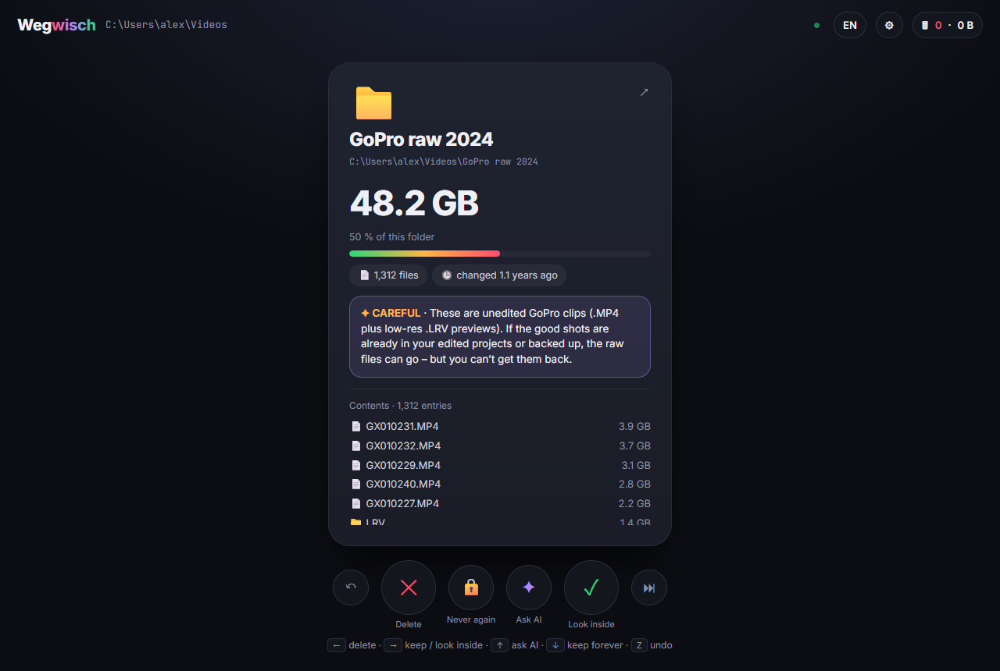
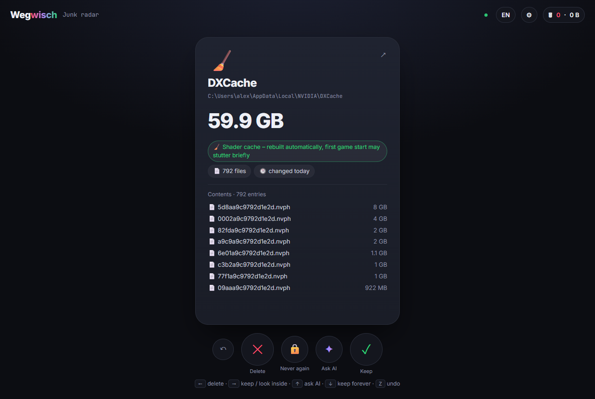
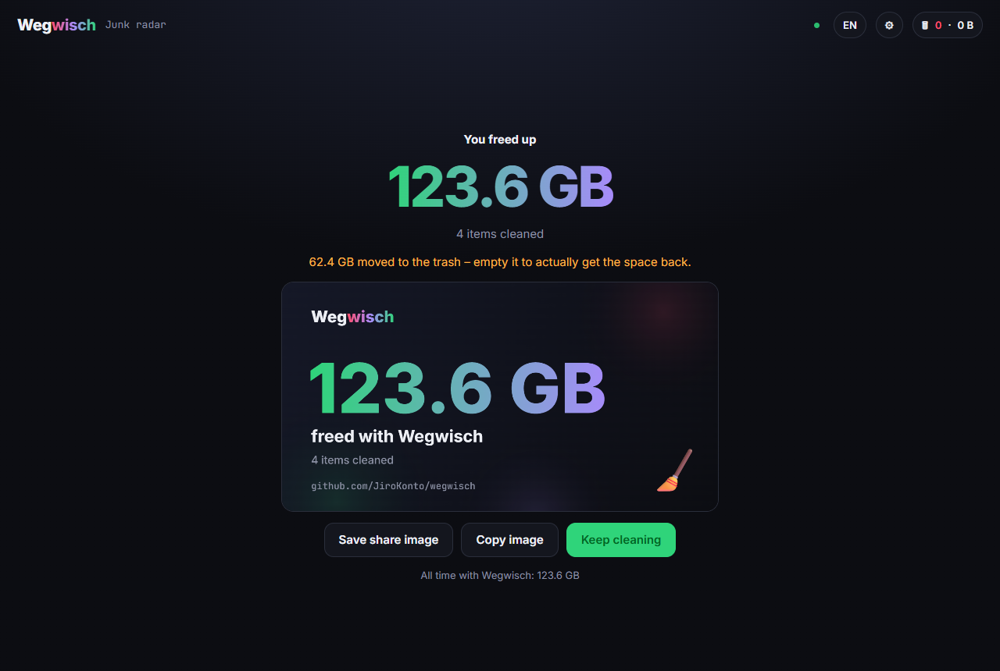

<div align="center">

# Weg<span>wisch</span> 🧹

**Tinder for your hard drive.** Swipe through what's eating your disk, biggest first.

← delete · → keep / look inside · ↑ ask an AI · ↓ never show again



</div>

---

Disk analyzers like WinDirStat or WizTree show you *what* is big. Then you're on your own, clicking through Explorer and deleting things one by one. Wegwisch turns cleanup into a quick decision loop: one card at a time, largest first, with enough context (size, age, contents, safety warnings) to decide in a second. If you don't know what something is, swipe up and an AI tells you.

Nothing is deleted while you swipe. Everything goes onto a **delete pile** that you review at the end, and it lands in the **Recycle Bin / Trash** by default.

*"Wegwisch" is German for "swipe it away".*

| Junk radar | Delete pile | Result |
|---|---|---|
|  |  |  |

## Features

- **Swipe or use the keyboard**: drag cards, or press `←` `→` `↑` `↓`, `Z` to undo, `S` to finish a folder.
- **Folders first, then deeper**: swiping right on a folder queues its contents as the next deck.
- **Fast parallel scanning**: a pool of worker threads (adjustable, 1–64) walks the disk. Folders you're looking at jump the queue. Sizes are the space *actually used on disk*, so sparse VM images and cloud placeholders don't show phantom gigabytes. Optionally scans all drives in the background.
- **Junk radar**: one deck of known-safe junk, including GPU shader caches, temp files, browser and dev caches (npm, pip, Gradle, Xcode DerivedData…), crash dumps and Windows update downloads. It also finds things *while* scanning:
  - `node_modules` in your projects
  - Unity `Library` folders
  - Unreal `Intermediate` / `DerivedDataCache`
  - Steam shader caches
  - `X.zip` lying next to an already unpacked `X/`
  - old installers in Downloads
- **Ask an AI (optional)**: swipe up and you get a verdict (DELETE / KEEP / CAREFUL) with a two-sentence reason. Works with:
  - [Claude Code](https://claude.com/claude-code) if it's installed (uses your existing login)
  - an Anthropic API key
  - a local model through [Ollama](https://ollama.com), so nothing leaves your machine

  Without any of these, the up-swipe is simply hidden.
- **Safety rules** (see below), tested for Windows, macOS and Linux.
- **Stats and a share image**: "You freed up 93.8 GB" as a PNG to save or copy.
- **English and German**, easy to extend (`public/i18n.js`).

## Install & run

Needs [Node.js](https://nodejs.org) 18.15 or newer.

```bash
npx wegwisch
```

or from source:

```bash
git clone https://github.com/JiroKonto/wegwisch
cd wegwisch
npm install
npm start
```

Your browser opens at `http://localhost:4747`. Options: `--port <n>`, `--threads <n>`, `--no-open`.

## Safety

Wegwisch deletes files, so it's paranoid by default:

| | What | Can you delete it? |
|---|---|---|
| 🔒 **Locked** | drive roots, the OS (`C:\Windows`, `/System`, `/usr`, …), `Program Files` / `ProgramData` roots, user profile roots and their standard folders (Desktop, Documents, Downloads…), `AppData\Local\Microsoft`, `~/.ssh` & other credential folders, **cloud-synced folders** (OneDrive, Dropbox, Google Drive, iCloud – deleting there deletes in the cloud), folders of **currently running programs**, and Wegwisch itself | No |
| ⚠ **Caution** | single program folders (uninstall properly instead), app data, Steam games, and **old Windows installations on other drives** (detected via their own `Windows\System32`) | Yes, with a warning |
| 🧹 **Junk** | caches & temp folders are *emptied*, never removed (apps expect them to exist) | Yes |

- **Trash first.** Everything goes to the Recycle Bin / Trash. Only caches skip it by default, because a cache in the trash frees nothing. That's a setting, and you can toggle each item on the delete pile.
- **Local only.** The server listens on `127.0.0.1` and checks the `Host` header (against DNS rebinding). Every API call needs a custom header, so other websites can't trigger it.
- **No links followed.** Symlinks and junctions are skipped, so nothing outside the folder you picked is touched.
- Rules live in [`src/protect.js`](src/protect.js) and are covered by tests (`npm test`).

Still: it's your disk. Read the card before you swipe.

## Where's my data?

Settings, the "never again" list and stats are stored per user. Nothing is in the app folder and nothing is sent anywhere.

- Windows: `%APPDATA%\wegwisch`
- macOS: `~/Library/Application Support/wegwisch`
- Linux: `~/.config/wegwisch`

An Anthropic API key, if you enter one, is stored there in plain text. Prefer the `ANTHROPIC_API_KEY` environment variable if that bothers you.

## How it works

```
bin/wegwisch.js      CLI entry
src/server.js        HTTP API + static UI (127.0.0.1 only)
src/scanner.js       worker-thread pool, priority queue, size roll-up
src/scan-worker.js   reads one directory level per task
src/protect.js       safety rules (pure, tested per OS)
src/junk.js          junk radar: known caches + detectors fed by the scanner
src/platform.js      drives, running programs, cloud folders, trash per OS
src/ai.js            Claude Code CLI / Anthropic API / Ollama
public/              the UI: plain HTML/CSS/JS, no build step
```

## Contributing

Issues and PRs are welcome, especially:
- junk rules for apps we don't know yet
- safety rules for setups we haven't seen
- translations

Run `npm test` before sending a PR that touches `protect.js`.

## License

[MIT](LICENSE)
